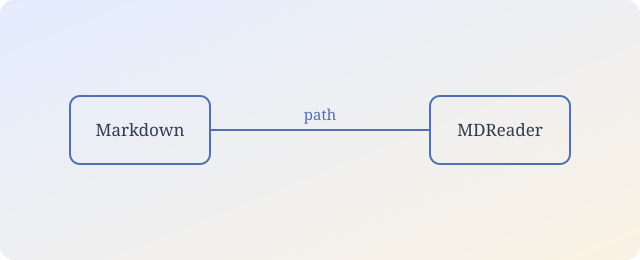

# 相对路径图片示例

这份文档放在 `sample/` 文件夹里，图片放在 `sample/images/` 里。

## 相对路径图片



## 公式

行内公式 $a^2 + b^2 = c^2$，行间公式：

$$
\int_0^1 x^2\,dx = \frac{1}{3}
$$

## 代码块与缩进

即使打开了正文首行缩进，代码块也不应该被缩进：

```cpp
int main() {
  return 0;
}
```

> 引用段落可以单独设置字体和缩进。中文阅读里，正文常用 2em 首行缩进，
> 而引用通常保持左对齐。

## HTML 子集

<details>
<summary>展开一段被允许的 HTML</summary>

这里有 <mark>高亮</mark>、<kbd>Ctrl</kbd> 和上标 x<sup>2</sup>。

</details>
